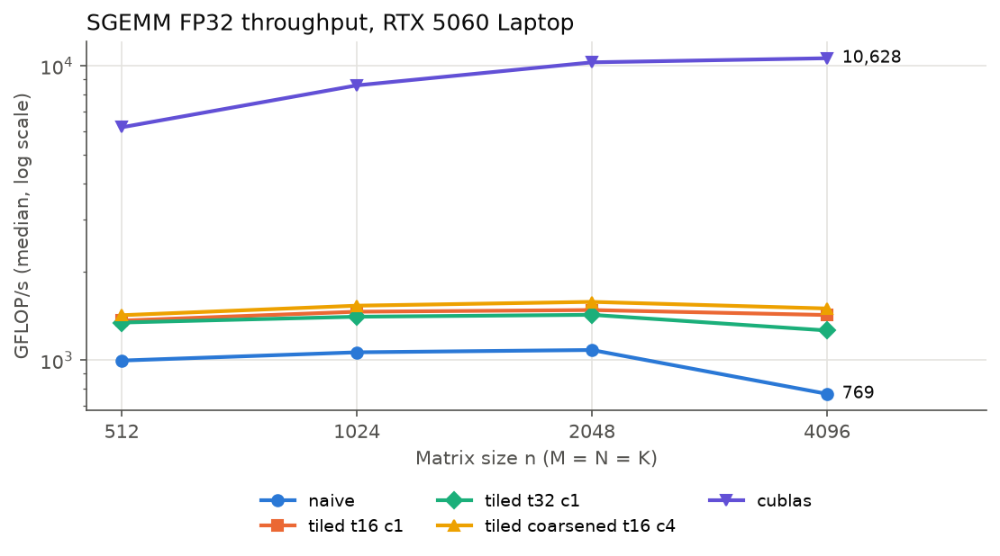
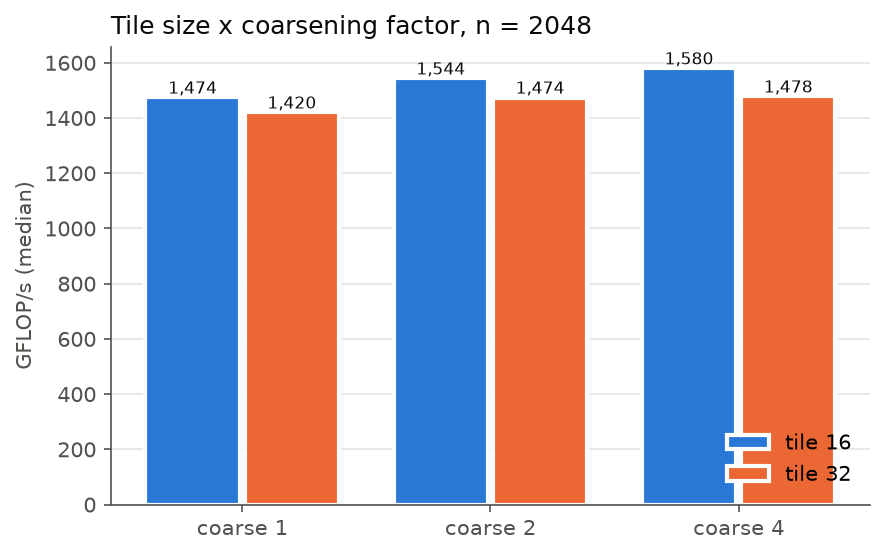

# pmpp-cuda-kernels

Hand-written CUDA kernels following *Programming Massively Parallel Processors* (4th ed., Hwu, Kirk & El Hajj), **tested, benchmarked against NVIDIA libraries and analysed** on an RTX 5060 Laptop GPU (Blackwell, sm_120).

The goal is not only to write the kernels of the book, but to work on them the way GPU performance work is done in practice: **correct first, measured rigorously, compared with the vendor library, and explained with the hardware model and the profiler.**

## Key results

| Kernel | Metric | Result | Reference |
|---|---|---|---|
| Vector add (ch. 2) | effective DRAM bandwidth | **347.6 GB/s** | **90.5 %** of the 384 GB/s theoretical peak |
| RGB → grayscale (ch. 3) | effective DRAM bandwidth | **333.2 GB/s** | **86.8 %** of peak |
| Best hand-written SGEMM (ch. 6, tile 16, coarsening ×4) | FP32 throughput, n = 4096 | **1,500 GFLOP/s** | **1.95×** the naive kernel, **14 %** of cuBLAS |
| cuBLAS SGEMM (reference) | FP32 throughput, n = 4096 | 10,628 GFLOP/s | FMA pipe active 69 % (Nsight Compute) |

- The two memory-bound kernels run close to the DRAM roofline: little is left to gain there.
- The SGEMM progression (naive → shared-memory tiling → coarsening) lands **within one point of an independent reference** ([Boehm's worklog](https://siboehm.com/articles/22/CUDA-MMM), RTX A6000) for the first two steps, and the README explains **why the third step gains 1.05× here and 2.85× there**: PMPP coarsening reduces global-memory traffic, while the bottleneck is shared-memory traffic per FMA.
- cuBLAS was identified with Nsight Compute as a CUTLASS **FP32 SIMT** kernel (no Tensor Cores), so the comparison is fair.

All kernels pass correctness tests on rectangular and non-tile-multiple shapes and `compute-sanitizer` (memcheck, racecheck) before being timed.

## Contents

1. [Memory-bound kernels](#memory-bound-kernels)
2. [SGEMM: from naive to cuBLAS](#sgemm-from-naive-to-cublas)
3. [Methodology](#methodology)
4. [Reproduce](#reproduce)
5. [Open questions and next steps](#open-questions-and-next-steps)
6. [Repository layout](#repository-layout)
7. [Chapter notes and exercises](#chapter-notes-and-exercises)

## Memory-bound kernels

Both kernels do a few operations per element, so their roofline limit is DRAM bandwidth. Sizes are chosen far above the 32 MiB L2 cache so that DRAM, not L2, is measured.

| Kernel | Size | Bytes moved | Median time | Effective bandwidth | % of theoretical peak |
|---|---|---|---|---|---|
| `vecadd` | 2²⁶ floats (256 MiB per array) | 3 × 256 MiB | 2.317 ms | 347.6 GB/s | 90.5 % |
| `color2gray` | 4096 × 4096 RGB pixels | 192 MiB read + 64 MiB written | 0.806 ms | 333.2 GB/s | 86.8 % |

Effective bandwidth = (bytes read + bytes written) / median kernel time. Theoretical peak: 128-bit bus × 24 Gbps GDDR7 = 384 GB/s.

`color2gray` used FP64 by accident (`0.21 * r` with `double` literals); switching to `0.21f` removed the FP64 instructions and lowered register use from 15 to 12. Its slightly lower bandwidth than `vecadd` is consistent with the strided RGB reads (12-byte stride between threads); not yet profiled.

## SGEMM: from naive to cuBLAS

C = A · B, FP32, row-major, square M = N = K = n.



| Kernel | n = 512 | n = 1024 | n = 2048 | n = 4096 |
|---|---|---|---|---|
| Naive (ch. 3) | 998 GFLOP/s (16 %) | 1,065 (12 %) | 1,084 (11 %) | 769 (7 %) |
| Tiled 16×16 (ch. 5) | 1,364 (22 %) | 1,463 (17 %) | 1,482 (14 %) | 1,425 (13 %) |
| Tiled 32×32 (ch. 5) | 1,344 (22 %) | 1,406 (16 %) | 1,428 (14 %) | 1,263 (12 %) |
| **Tiled 16×16 + coarsening ×4 (ch. 6)** | 1,423 (23 %) | 1,533 (18 %) | **1,580 (15 %)** | **1,500 (14 %)** |
| cuBLAS SGEMM | 6,191 | 8,595 | 10,291 | 10,628 |

Median of 30 runs; GFLOP/s = 2·M·N·K / time; percentages relative to cuBLAS at the same size. Full sweep (10 configurations × 4 sizes): [`results/sweep_matmul.csv`](results/sweep_matmul.csv).

### Findings



1. **Tile 16 beats tile 32** (+4 % at n = 2048, +13 % at n = 4096) although tile 32 halves global-memory traffic. A 1024-thread block is the only block that fits on an SM (1536 threads max), so occupancy is capped at 67 % and all 32 warps stall together at each `__syncthreads()`. Global traffic is not the limiter.
2. **Coarsening helps little**: +5 % (×2) and +7 % (×4) at n = 2048. Explained below.
3. **Wave quantization**: tile 32 × coarsening 4 at n = 512 launches 64 blocks on 26 SMs at 1 block/SM, i.e. 3 waves with the last one 12/26 full. Predicted efficiency 64/78 = 82 %, measured 86 %.
4. **The naive kernel loses 29 % from n = 2048 to 4096**, when one matrix (64 MiB) no longer fits in the 32 MiB L2. cuBLAS is unaffected.
5. **Coarsening ×1 matches the plain tiled kernel** (1,474 vs 1,482 GFLOP/s): no overhead, and a check that the measurements are reproducible.

### Why coarsening gains 1.05× here and 2.85× in Boehm's worklog

| Step | Boehm (A6000, n = 4092) | This repo (n = 4096) |
|---|---|---|
| Naive, coalesced | 8.5 % of cuBLAS | 7.2 % |
| 32×32 shared-memory tiling | 12.8 % | 11.9 % |
| Several outputs per thread | 36.5 % (1D blocktiling, 8 outputs), **×2.85** | 14.1 % (coarsening ×4), **×1.05** vs tile 16 |

Both kernels compute several outputs per thread; the difference is **what is reused from registers**.

| Kernel | Global loads per output | Shared-memory loads per output |
|---|---|---|
| Boehm kernel 3 (32×32 tiles) | K/16 | 2K |
| Boehm kernel 4 (1D, 8 outputs/thread) | K/32 | **9K/8** |
| ch. 6 (tile 16, coarsening ×4) | ≈ K/13 | **2K** |

PMPP coarsening reuses the A tile across output columns, which cuts global traffic. But the output loop is the *outer* loop, with a barrier and a new B tile per output, so every `As[ty][k]` is read again from shared memory:

```cpp
for (int c = 0; c < COARSE_FACTOR; c++) {      // outer: one B tile per output
    /* load Bs for column block c */ __syncthreads();
    for (int k = 0; k < TILE_WIDTH; k++)
        Pval[c] += As[ty][k] * Bs[k][tx];       // 2 shared loads per FMA
    __syncthreads();
}
```

Boehm puts the K loop outside: one shared-memory value goes to a register and feeds 8 FMAs. **The chapter 5-6 techniques reduce global-memory traffic, which is not the bottleneck once data sits in L1/L2 and shared memory; closing the gap requires reducing shared-memory traffic per FMA, i.e. register tiling.**

### What cuBLAS does differently

Nsight Compute shows that cuBLAS runs `cutlass_80_simt_sgemm_128x64_8x5_nn_align1` at n = 4096: a plain FP32 CUTLASS kernel with

- **register tiling**: a 128×64 output tile per 128-thread block, i.e. 64 outputs per thread (vs 1 to 4 here);
- **a 5-stage software pipeline**: the next K-tiles load while the current one is computed.

Its FMA pipe is active 69 % of the time, at an SM clock of 2.69 GHz measured during the kernel (FP32 peak at that clock: 128 lanes × 26 SMs × 2 × 2.69 GHz ≈ 17.9 TFLOP/s).

## Methodology

**Correctness before speed.** Each SGEMM variant, including cuBLAS, goes through the same test: 9 shapes (degenerate, thin, rectangular, non-multiples of the tile size, 1024³), FP64 CPU reference, relative tolerance K·ε derived from the floating-point error bound of a dot product of non-negative terms, output pre-filled with NaN to catch unwritten elements. Then `compute-sanitizer` memcheck and racecheck. The sweep script refuses to benchmark a configuration whose test fails.

**Timing** ([`utils/bench.h`](utils/bench.h)): kernel time only, CUDA events around each launch, transfers measured separately. Warmup of ≥ 300 ms (a laptop GPU idles in a low-power state), then 30 timed runs; the **median** is reported, min / max / stddev are kept in the CSV.

**Clock and power on a laptop.** The SM clock is measured inside a kernel (`clock64()` cycles / `%globaltimer` ns, [`utils/clock_probe.cu`](utils/clock_probe.cu)) before and after each sweep, and with Nsight Compute during the cuBLAS kernel (`--clock-control none`, since `ncu` locks the base clock by default). The power mode changes everything: 1.56 GHz in Lenovo "Quiet" mode, 2.75 GHz in "Balanced" / "Performance". All results: **Performance mode, on AC power**.

**Known variability.** Tile-16 SGEMM at n = 4096 shows a 4-6 % stddev while tile 32 stays below 0.2 %. The fastest configurations run at the 80 W power limit; the median is robust to the resulting clock oscillations.

**Hardware and software.** NVIDIA GeForce RTX 5060 Laptop GPU (Blackwell, cc 12.0, 26 SMs, 8 GB GDDR7, 32 MiB L2, 80 W). Windows + WSL2 (Ubuntu), CUDA 13.3, driver 592.15, Nsight Compute 2026.2, Nsight Systems 2026.1.

## Reproduce

Requires a CUDA toolkit ≥ 12.8 (sm_120 support), GNU Make, and Python 3 with pandas and matplotlib for the figures. Builds for the local GPU (`-arch=native`); override with `make ARCH=sm_XX`.

```bash
git clone https://github.com/leedouardpro-code/pmpp-cuda-kernels.git
cd pmpp-cuda-kernels

make -C utils query probe                # GPU specs, measured SM clock
make -C ch5/matmul_tiling test bench     # one kernel: correctness tests, then benchmark
make -C ch5/matmul_tiling EXTRA="-DTILE_WIDTH=16" clean test bench   # another tile size

scripts/sweep_matmul.sh                  # all SGEMM variants x sizes -> results/sweep_matmul.csv
python3 scripts/plot_matmul.py           # tables and figures in results/
```

On a laptop, plug in the charger and select the highest performance mode first; [`results/env_matmul.txt`](results/env_matmul.txt) records the clock measured before and after the sweep.

## Open questions and next steps

Hypotheses stated above that are **not yet confirmed by profiling**, and the planned work:

- [ ] Profile the hand-written SGEMM kernels with Nsight Compute: is the tiled kernel limited by the shared-memory pipeline (*MIO throttle* stalls, as in Boehm's profile)? Does tile 32 lose time at barriers?
- [ ] Parallel reduction (PMPP ch. 10), from the naive version to warp shuffles, compared with CUB `DeviceReduce`.
- [ ] Roofline plot of all kernels from Nsight Compute counters.
- [ ] SGEMM: move the K loop outside the output loop (1D register tiling), then 2D register tiling and `float4` loads (36.5 % → 78.4 % of cuBLAS in Boehm's worklog).

## Repository layout

One folder per kernel, same layout everywhere: `xxx.cu` (kernel, launch function, GPU wrapper), `test_xxx.cu` (correctness vs CPU), `bench_xxx.cu` (timing), and a `Makefile` with `test` / `bench` / `clean` targets.

<details>
<summary>Full tree</summary>

```
pmpp-cuda-kernels/
├── common.mk                   # shared build settings (flags, EXTRA defines, header tracking)
├── utils/
│   ├── bench.h                 # statistical timing harness
│   ├── clock_probe.cu          # measured SM clock and practical FP32 peak
│   ├── cuda_check.h            # CUDA_CHECK error-handling macro
│   ├── device_query.{h,cu}     # device limits and theoretical peaks
│   ├── device_query_main.cu
│   └── Makefile                # `make query`, `make probe`
├── ch2/vecadd/                 # vector addition (memory-bound)
├── ch3/color2gray/             # RGB to grayscale (memory-bound)
├── ch3/matmul/                 # naive SGEMM; test_matmul.cu / bench_matmul.cu shared by all SGEMM folders
├── ch4/README.md               # exercises: warps, divergence, occupancy
├── ch5/README.md               # exercises: tiling, roofline, occupancy
├── ch5/matmul_tiling/          # shared-memory tiled SGEMM (TILE_WIDTH at compile time)
├── ch6/matmul_coarsening/      # tiling + thread coarsening (TILE_WIDTH, COARSE_FACTOR)
├── cublas/                     # cuBLAS SGEMM reference behind the same interface
├── scripts/
│   ├── sweep_matmul.sh         # build, test and benchmark every SGEMM variant
│   └── plot_matmul.py          # tables and figures from the sweep CSV
└── results/                    # raw data behind the numbers above (CSV, environment, build log, figures)
```

</details>

## Chapter notes and exercises

| Chapter | Topic | Code | Notes |
|---|---|---|---|
| 2 | Heterogeneous data parallel computing | [`vecadd`](ch2/vecadd) | |
| 3 | Multidimensional grids and data | [`color2gray`](ch3/color2gray), [`matmul`](ch3/matmul) | |
| 4 | Compute architecture and scheduling | | [exercises](ch4/README.md) |
| 5 | Memory architecture and data locality | [`matmul_tiling`](ch5/matmul_tiling) | [exercises](ch5/README.md) |
| 6 | Performance considerations | [`matmul_coarsening`](ch6/matmul_coarsening) | |

Conventions: `_h` / `_d` suffixes for host / device pointers, every CUDA API call wrapped in `CUDA_CHECK`, `cudaGetLastError()` after each launch. All kernels are hand-written; `cublas/` is the vendor reference.

## References

- W. Hwu, D. Kirk, I. El Hajj, *Programming Massively Parallel Processors*, 4th ed., 2023
- S. Boehm, [How to Optimize a CUDA Matmul Kernel for cuBLAS-like Performance: a Worklog](https://siboehm.com/articles/22/CUDA-MMM), 2022
- NVIDIA, [CUDA C++ Programming Guide](https://docs.nvidia.com/cuda/cuda-c-programming-guide/), [CUDA C++ Best Practices Guide](https://docs.nvidia.com/cuda/cuda-c-best-practices-guide/), [Nsight Compute Kernel Profiling Guide](https://docs.nvidia.com/nsight-compute/ProfilingGuide/)
- N. J. Higham, *Accuracy and Stability of Numerical Algorithms*, 2nd ed., SIAM, 2002 (error bound used for the test tolerance)
- [GPU MODE lectures](https://github.com/gpu-mode/lectures)